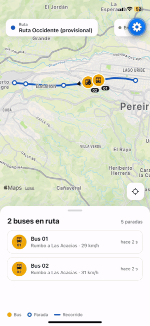
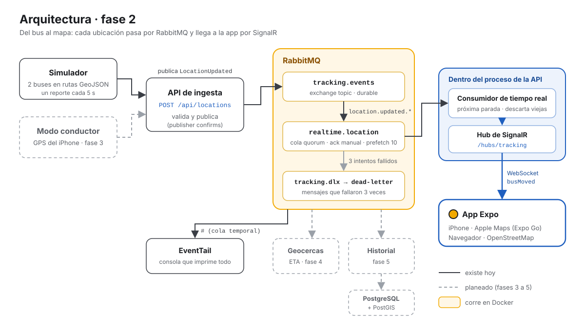

# realtime-bus-tracking

Prueba de concepto: buses escolares simulados reportan su ubicación, un backend en .NET distribuye cada evento por RabbitMQ a consumidores independientes y una app en React Native (Expo) muestra los buses moviéndose en un mapa en tiempo real.

**Estado: fase 3 de 5.** Los buses se mueven en vivo en un mapa, en el iPhone (Expo Go) y en el navegador, y el iPhone puede hacer de bus en el **modo conductor** enviando su GPS real. Las geocercas y el historial llegan en las fases siguientes ([roadmap](docs/brief.md#roadmap)).

<p align="center">
  
</p>

## Arquitectura

<p align="center">
  
</p>

Las líneas continuas ya existen; las punteadas están planeadas. El consumidor de tiempo real y el hub corren dentro del proceso de la API. El modo conductor usa el mismo `POST /api/locations` que el simulador, así que el resto del camino es idéntico. El diagrama es [`docs/media/architecture.svg`](docs/media/architecture.svg).

| Evento | Clave de enrutamiento | Lo publica | Colas |
| --- | --- | --- | --- |
| `LocationUpdated` | `location.updated.{routeId}` | API de ingesta | `realtime.location` |

Cada mensaje es JSON persistente (camelCase), con `MessageId = eventId` y `Type = LocationUpdated`. La API usa *publisher confirms*: solo responde `202 Accepted` cuando RabbitMQ ya tiene el mensaje.

Cada consumidor tiene su propia cola durable de tipo **quorum**, con *ack* manual y un `prefetch` de 10:
- Un mensaje cuyo procesamiento sigue fallando se reintenta. Después de 3 intentos (`x-delivery-limit`) pasa a `tracking.dead-letter`.
- Un mensaje que no se puede leer va directo a esa cola.
- Un `eventId` que ya se procesó se ignora.
- El consumidor de tiempo real descarta una posición registrada antes que la última del bus, para que el mapa nunca mueva un bus hacia atrás.

> Desde RabbitMQ 4.3, solo `basic.reject` cuenta para `x-delivery-limit` (`basic.nack` no). Por eso los consumidores rechazan con *reject* los mensajes que fallan.

## Cómo correrlo

Requisitos:
- Docker Desktop;
- .NET 10 SDK;
- Node.js 22.13 o superior (se recomienda la 24 LTS);
- para el teléfono, la app Expo Go y una [cuenta de Expo](https://expo.dev/signup) gratuita.

```bash
# 1. RabbitMQ (management UI at http://localhost:15672)
cp infra/.env.example infra/.env        # then change the password
docker compose -f infra/docker-compose.yml up -d

# 2. The same password for the API and EventTail (they share a User Secrets id)
dotnet user-secrets set "RabbitMq:Password" "<password from infra/.env>" --project backend/src/BusTracking.Api
```

Luego, cada uno en su propia terminal:

```bash
cd backend/src/BusTracking.Api && dotnet run              # http://localhost:5080 (use --launch-profile lan for a phone)
cd backend/src/BusTracking.Simulator && dotnet run        # 2 buses on route-01, a report every 5 s
cd backend/tools/BusTracking.EventTail && dotnet run      # optional: prints every event
```

EventTail acepta un patrón de enlace: `dotnet run -- --pattern location.updated.route-01`.

Hay peticiones de ejemplo en [`BusTracking.Api.http`](backend/src/BusTracking.Api/BusTracking.Api.http).

### API

| Endpoint | Qué hace |
| --- | --- |
| `POST /api/locations` | Recibe un reporte de ubicación y publica `LocationUpdated` |
| `GET /api/routes`, `GET /api/routes/{routeId}` | Las rutas, con su recorrido y paradas, para dibujarlas |
| `GET /api/buses` | La flota (`Fleet:BusIds`) y qué buses están en uso: reportaron en los últimos 60 s |
| `GET /health` | `200` mientras la conexión con RabbitMQ esté abierta |
| SignalR `/hubs/tracking` | `JoinRoute(routeId)` devuelve las posiciones actuales de los buses y suscribe a `busMoved`. Cada posición trae la próxima parada y `distanceFromRouteMeters` |

## La app

La app está en [`mobile/`](mobile): Expo **SDK 58**, TypeScript y una sola pantalla con el mapa en vivo. En el iPhone usa Apple Maps (`react-native-maps`). En el navegador usa los mapas de OpenStreetMap (`react-leaflet`), porque `react-native-maps` no funciona en web.

> Expo Go del App Store solo abre proyectos del SDK más reciente. Si Expo Go dice que el proyecto es incompatible, revisa qué SDK soporta antes de actualizar.

```bash
cd mobile
npm install
cp .env.example .env          # EXPO_PUBLIC_API_URL=http://<pc-ip>:5080
npx expo login                # the same free Expo account you use in Expo Go
npx expo start                # scan the QR code with the iPhone camera; press w for the browser
```

La app tiene dos modos:

- **Padre** (al abrirla): sigue la primera ruta y muestra la próxima parada, la velocidad y el rumbo de cada bus. Se reconecta sola: mientras no llega al servidor, muestra "Reconectando" y deja los buses en gris en su última posición conocida.
- **Conductor** (botón "Modo conductor"): eliges un bus libre de la flota y la ruta, y la app envía el GPS del iPhone a `POST /api/locations` cada 5 s.
  - Las lecturas con precisión peor que 30 m no se envían ("Señal GPS débil").
  - A más de 150 m de la línea de la ruta aparece "Estás fuera de la ruta"; se sigue enviando, sin próxima parada.
  - Expo Go solo lee el GPS **con la app abierta**: si la cierras o bloqueas el teléfono, el envío se detiene. El GPS en segundo plano necesita un *development build* (fase 6).

Para la demo: el iPhone en modo conductor y el navegador del PC en modo padre (`w` en la terminal de Expo), viendo moverse tu recorrido.

### Conectar el teléfono al PC

El teléfono necesita llegar a la API (puerto 5080) y al servidor de Expo (puerto 8081). En Windows:

1. Busca la IP del PC en el adaptador Wi-Fi con `ipconfig` → *Dirección IPv4* (por ejemplo `192.168.1.10`) y ponla en `mobile/.env`.
2. Marca la red Wi-Fi como **privada** y permite los dos puertos en el Firewall. Se hace una sola vez, en un PowerShell de **administrador**:

   ```powershell
   Set-NetConnectionProfile -InterfaceAlias "Wi-Fi" -NetworkCategory Private
   New-NetFirewallRule -DisplayName "BusTracking API 5080" -Direction Inbound -Protocol TCP -LocalPort 5080 -Action Allow -Profile Private
   New-NetFirewallRule -DisplayName "BusTracking Expo 8081" -Direction Inbound -Protocol TCP -LocalPort 8081 -Action Allow -Profile Private
   ```

   Hazlo solo en una red de confianza, como la de tu casa, nunca en un Wi-Fi público.
3. Corre la API con el perfil `lan`, que escucha en todas las interfaces: `dotnet run --launch-profile lan`.
4. Desde Safari en el teléfono, conectado al mismo Wi-Fi, abre `http://<pc-ip>:5080/health`. Debe mostrar `healthy`.

Si el teléfono sigue sin llegar al PC (algunos routers aíslan a los dispositivos del Wi-Fi), usa un túnel: `ngrok http 5080` da una URL pública con HTTPS para la API.

La versión web llama a la API desde `http://localhost:8081`. Ese origen está permitido en Development con `Cors:AllowedOrigins`, en `appsettings.json`.

## Rutas

Las rutas están en [`data/routes/`](data/routes) como GeoJSON dibujado en [geojson.io](https://geojson.io):
- una `LineString` con `routeId` y `name`;
- un `Point` por parada, con `stopId`, `name` y `order`.

Las posiciones van como `[longitud, latitud]`. Todos los nombres son ficticios. `route-01` es una ruta provisional en Pereira, Colombia.

## Pruebas

```bash
dotnet test backend/BusTracking.slnx     # unit + integration (Testcontainers: Docker must be running)
cd mobile && npm run typecheck && npm run lint && npm test
```

Las pruebas de integración recorren todo el camino en tiempo real con un RabbitMQ real: `POST /api/locations` → RabbitMQ → `realtime.location` → cliente de SignalR. También cubren los reintentos, la cola de fallidos, la idempotencia y la flota. En la app, jest prueba la lógica pura: posiciones viejas, formatos, la conversión de las lecturas del GPS y la latencia.

## Métricas

| Camino | p50 | p95 | Medición |
| --- | --- | --- | --- |
| Simulador → RabbitMQ → EventTail | 4 ms | 16 ms | Fase 1, 26 mensajes en un PC local |

Falta medir la latencia de punta a punta hasta la app (`ahora - recordedAt`, p50 y p95). En desarrollo, la app la escribe cada minuto en la terminal de Expo: `latency to app over N positions: p50 … ms, p95 … ms`.

## Documentación

- [Brief y roadmap](docs/brief.md)
- [Handoffs de cada fase](docs/handoffs/): el plan que se le entrega a Claude Code en cada fase

## Licencia

[MIT](LICENSE)
