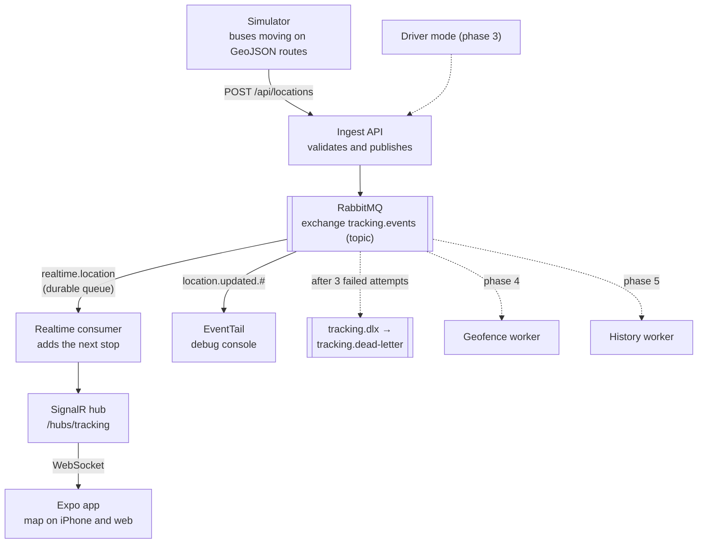

# realtime-bus-tracking

Proof of concept: simulated school buses report their position, a .NET backend fans each event out through RabbitMQ to independent consumers, and a React Native (Expo) app shows the buses moving on a map in real time.

**Status: phase 2 of 5** — the buses move live on a map in the iPhone (Expo Go) and in the browser. Driver mode, geofences and history come in later phases ([roadmap](docs/brief.md#roadmap)).

## Architecture



Solid lines exist today; dotted lines are planned. The realtime consumer and the hub run inside the API process.

| Event | Routing key | Published by | Queues |
| --- | --- | --- | --- |
| `LocationUpdated` | `location.updated.{routeId}` | Ingest API | `realtime.location` |

Every message is persistent JSON (camelCase) with `MessageId = eventId` and `Type = LocationUpdated`. The API uses publisher confirms: it only answers `202 Accepted` once RabbitMQ has the message.

Each consumer owns a durable **quorum** queue with manual acks and a prefetch of 10. A message whose handler keeps failing is retried and, after 3 attempts (`x-delivery-limit`), moves to `tracking.dead-letter`; unreadable messages go there straight away. Consumers skip an `eventId` they already handled, and the realtime consumer drops a position recorded before the bus's latest one, so the map never moves a bus backwards.

> Since RabbitMQ 4.3 only `basic.reject` counts towards `x-delivery-limit` (`basic.nack` does not), so the consumers reject a failed message instead of nacking it.

## Run it locally

Requirements: Docker Desktop, .NET 10 SDK, Node.js 22.13 or later (24 LTS recommended), and for the phone the Expo Go app plus a free [Expo account](https://expo.dev/signup).

```bash
# 1. RabbitMQ (management UI at http://localhost:15672)
cp infra/.env.example infra/.env        # then change the password
docker compose -f infra/docker-compose.yml up -d

# 2. The same password for the API and EventTail (they share a User Secrets id)
dotnet user-secrets set "RabbitMq:Password" "<password from infra/.env>" --project backend/src/BusTracking.Api
```

Then, in separate terminals:

```bash
cd backend/src/BusTracking.Api && dotnet run              # http://localhost:5080 (use --launch-profile lan for a phone)
cd backend/src/BusTracking.Simulator && dotnet run        # 2 buses on route-01, a report every 5 s
cd backend/tools/BusTracking.EventTail && dotnet run      # optional: prints every event
```

EventTail accepts a binding pattern: `dotnet run -- --pattern location.updated.route-01`.

Manual requests are in [`BusTracking.Api.http`](backend/src/BusTracking.Api/BusTracking.Api.http).

### API

| Endpoint | What it does |
| --- | --- |
| `POST /api/locations` | Ingests a location report and publishes `LocationUpdated` |
| `GET /api/routes`, `GET /api/routes/{routeId}` | The routes, with their path and stops, to draw them |
| `GET /health` | `200` while the RabbitMQ connection is open |
| SignalR `/hubs/tracking` | `JoinRoute(routeId)` returns the buses' current positions and subscribes to `busMoved` |

## The app

The app lives in [`mobile/`](mobile): Expo **SDK 58**, TypeScript, one screen with the live map. The iPhone uses Apple Maps (`react-native-maps`); the browser uses OpenStreetMap tiles (`react-leaflet`), because `react-native-maps` has no web support.

> Expo Go on the App Store only runs the latest SDK. If Expo Go says the project is incompatible, check which SDK it supports before upgrading.

```bash
cd mobile
npm install
cp .env.example .env          # EXPO_PUBLIC_API_URL=http://<pc-ip>:5080
npx expo login                # the same free Expo account you use in Expo Go
npx expo start                # scan the QR code with the iPhone camera; press w for the browser
```

The app follows the first route, shows each bus's next stop, speed and heading, and reconnects on its own: while the server is unreachable it shows "Reconectando" and greys out the buses at their last known position.

### Reach the PC from a phone

The phone needs the API (5080) and the Expo dev server (8081). On Windows:

1. Find the PC's IP on the Wi-Fi adapter: `ipconfig` → *IPv4 Address* (for example `192.168.1.10`), and put it in `mobile/.env`.
2. Mark the Wi-Fi network as **private** and allow both ports through the firewall. Once, in an **administrator** PowerShell:

   ```powershell
   Set-NetConnectionProfile -InterfaceAlias "Wi-Fi" -NetworkCategory Private
   New-NetFirewallRule -DisplayName "BusTracking API 5080" -Direction Inbound -Protocol TCP -LocalPort 5080 -Action Allow -Profile Private
   New-NetFirewallRule -DisplayName "BusTracking Expo 8081" -Direction Inbound -Protocol TCP -LocalPort 8081 -Action Allow -Profile Private
   ```

   Only do this on a network you trust (home), never on public Wi-Fi.
3. Run the API with the `lan` profile, which listens on every interface: `dotnet run --launch-profile lan`.
4. From Safari on the phone (same Wi-Fi), open `http://<pc-ip>:5080/health`: it should show `healthy`.

If the phone still cannot reach the PC (some routers isolate Wi-Fi clients), use a tunnel instead: `ngrok http 5080` gives a public HTTPS URL for the API.

The browser version calls the API from `http://localhost:8081`, which `Cors:AllowedOrigins` in `appsettings.json` allows in Development.

## Routes

Routes live in [`data/routes/`](data/routes) as GeoJSON drawn in [geojson.io](https://geojson.io): one `LineString` with `routeId` and `name`, plus one `Point` per stop with `stopId`, `name` and `order`. Positions are `[longitude, latitude]`. All names are fictitious; `route-01` is a provisional route in Pereira, Colombia.

## Tests

```bash
dotnet test backend/BusTracking.slnx     # unit + integration (Testcontainers: Docker must be running)
cd mobile && npm run typecheck && npm run lint && npm test
```

The integration tests cover the whole realtime path with a real broker: `POST /api/locations` → RabbitMQ → `realtime.location` → SignalR client, plus retries, the dead letter queue and idempotency.

## Metrics

| Path | p50 | p95 | Measured |
| --- | --- | --- | --- |
| Simulator → RabbitMQ → EventTail | 4 ms | 16 ms | Phase 1, 26 messages on a local PC |

The end-to-end latency to the app (`now - recordedAt` on the phone, p50 and p95) is still to be measured.

## Docs

- [Brief and roadmap](docs/brief.md)
- [Phase handoffs](docs/handoffs/) — the plan given to Claude Code for each phase

## License

[MIT](LICENSE)
