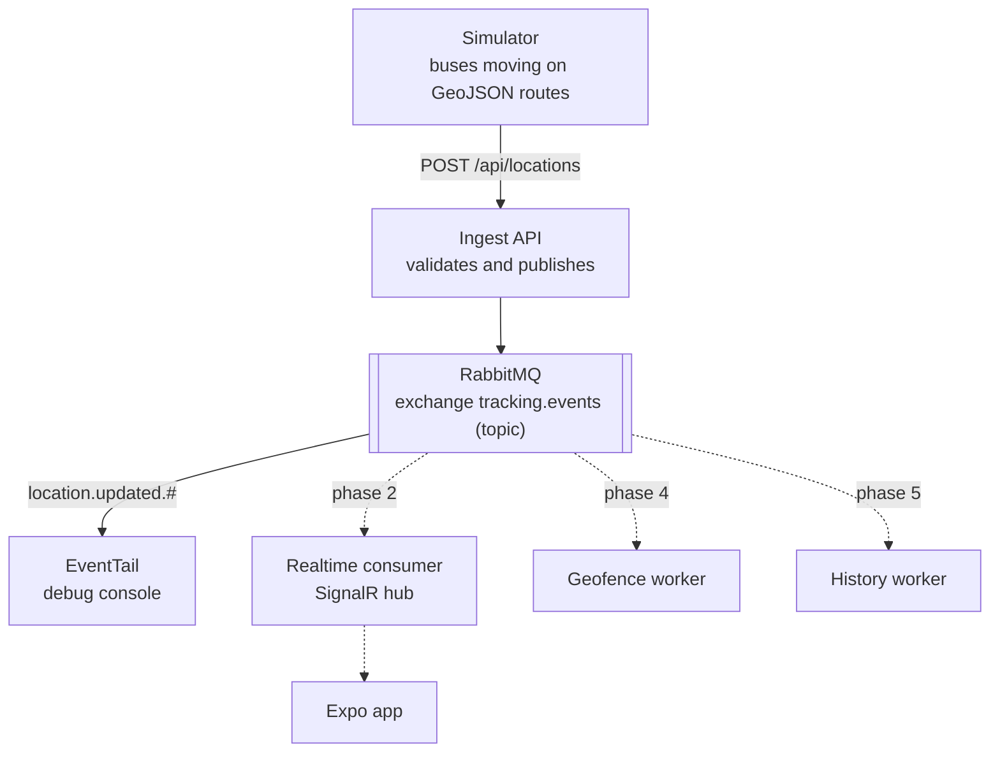

# realtime-bus-tracking

Proof of concept: simulated school buses report their position, a .NET backend fans each event out through RabbitMQ to independent consumers, and a React Native (Expo) app shows the buses moving on a map in real time.

**Status: phase 1 of 5** — ingest API, RabbitMQ and route simulator. The app, SignalR, geofences and history come in later phases ([roadmap](docs/brief.md#roadmap)).

## Architecture



Solid lines exist today; dotted lines are planned.

| Event | Routing key | Published by |
| --- | --- | --- |
| `LocationUpdated` | `location.updated.{routeId}` | Ingest API |

Every message is persistent JSON (camelCase) with `MessageId = eventId` and `Type = LocationUpdated`. The API uses publisher confirms: it only answers `202 Accepted` once RabbitMQ has the message.

## Run it locally

Requirements: Docker Desktop, .NET 10 SDK.

```bash
# 1. RabbitMQ (management UI at http://localhost:15672)
cp infra/.env.example infra/.env        # then change the password
docker compose -f infra/docker-compose.yml up -d

# 2. The same password for the API and EventTail (they share a User Secrets id)
dotnet user-secrets set "RabbitMq:Password" "<password from infra/.env>" --project backend/src/BusTracking.Api
```

Then, in three terminals:

```bash
cd backend/src/BusTracking.Api && dotnet run              # http://localhost:5080
cd backend/tools/BusTracking.EventTail && dotnet run      # prints every event
cd backend/src/BusTracking.Simulator && dotnet run        # 2 buses on route-01
```

EventTail accepts a binding pattern: `dotnet run -- --pattern location.updated.route-01`.

Manual requests are in [`BusTracking.Api.http`](backend/src/BusTracking.Api/BusTracking.Api.http).

### Reach the API from a phone

The default profile only listens on `localhost`. To open the API (and the Expo dev server) to your local network, on Windows:

1. Find the PC's IP on the Wi-Fi adapter: `ipconfig` → *IPv4 Address* (for example `192.168.1.10`).
2. Mark the Wi-Fi network as **private**, and allow the API (5080) and the Expo dev server (8081) through the firewall. Once, in an **administrator** PowerShell:

   ```powershell
   Set-NetConnectionProfile -InterfaceAlias "Wi-Fi" -NetworkCategory Private
   New-NetFirewallRule -DisplayName "BusTracking API 5080" -Direction Inbound -Protocol TCP -LocalPort 5080 -Action Allow -Profile Private
   New-NetFirewallRule -DisplayName "BusTracking Expo 8081" -Direction Inbound -Protocol TCP -LocalPort 8081 -Action Allow -Profile Private
   ```

   Only do this on a network you trust (home), never on public Wi-Fi.
3. Run the API with the `lan` profile, which listens on every interface:

   ```bash
   cd backend/src/BusTracking.Api && dotnet run --launch-profile lan
   ```

4. From Safari on the phone (same Wi-Fi), open `http://<pc-ip>:5080/health`: it should show `healthy`.

If the phone still cannot reach the PC (some routers isolate Wi-Fi clients), use a tunnel instead: `ngrok http 5080` gives a public HTTPS URL for the API.

## Routes

Routes live in [`data/routes/`](data/routes) as GeoJSON drawn in [geojson.io](https://geojson.io): one `LineString` with `routeId` and `name`, plus one `Point` per stop with `stopId`, `name` and `order`. Positions are `[longitude, latitude]`. All names are fictitious; `route-01` is a provisional route in Pereira, Colombia.

## Tests

```bash
dotnet test backend/BusTracking.slnx
```

Integration tests start RabbitMQ with Testcontainers, so Docker must be running.

## Docs

- [Brief and roadmap](docs/brief.md)
- [Phase handoffs](docs/handoffs/) — the plan given to Claude Code for each phase

## License

[MIT](LICENSE)
