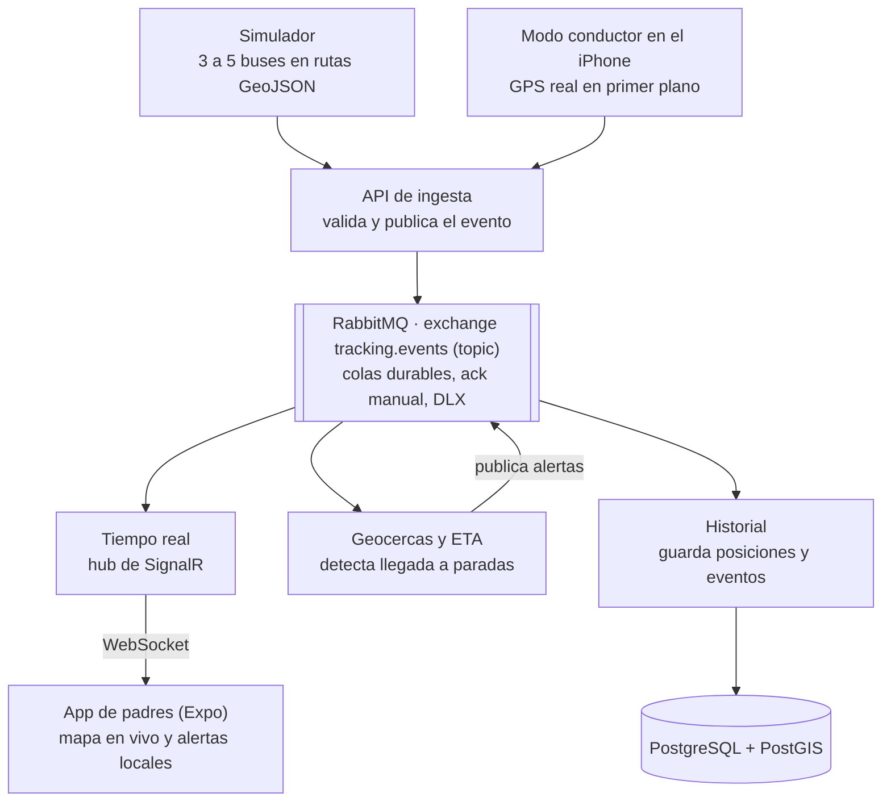
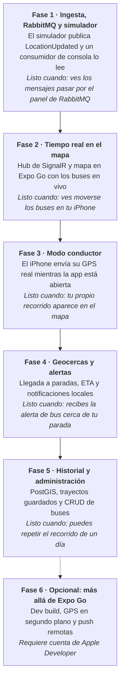

# Brief y roadmap: POC de monitoreo de rutas en tiempo real

## Resumen

Una prueba de concepto (POC), no un producto: buses escolares que envían su ubicación cada pocos segundos y una app móvil donde los padres los ven moverse en el mapa y reciben un aviso cuando el bus se acerca a su parada.

Junta en un solo proyecto tres objetivos: **una app con React Native**, **mensajería con RabbitMQ** y **tiempo real sobre un mapa**, además de lógica geoespacial (geocercas y tiempo estimado de llegada).

La demo no depende de manejar un bus: un **simulador** mueve varios buses sobre rutas reales de Pereira, y un iPhone hace de padre (o de conductor con su GPS real). Todo corre en un PC con Windows 11 y en Expo Go, sin costo.

## Alcance de la POC

La POC demuestra el flujo completo de un evento de ubicación, del bus al celular del padre, pasando por un bus de mensajería con varios consumidores independientes.

**Incluye**

- Simulador de 3 a 5 buses sobre rutas de Pereira.
- API de ingesta que recibe ubicaciones y las publica en RabbitMQ.
- Tres consumidores: difusión en tiempo real (SignalR), geocercas con tiempo estimado de llegada, e historial en PostgreSQL + PostGIS.
- App en React Native con Expo: mapa en vivo, aviso de llegada con notificación local, modo conductor con el GPS del iPhone (con la app abierta) y CRUD de buses con formularios.
- Métricas para el README: latencia de punta a punta y mensajes por segundo.

**Fuera de alcance**

- Multiempresa, usuarios, cobros o cualquier cosa de SaaS.
- GPS en segundo plano y notificaciones push (necesitan *development build* y cuenta de Apple Developer).
- Despliegue en la nube: corre local, solo para demos.
- Escalar SignalR a varios servidores (backplane con Redis).
- Datos reales de niños: solo nombres y paradas inventados.
- CRUD de rutas y paradas: se definen en GeoJSON (`data/routes/`) y la app solo las lee.

## Arquitectura



Los productores (simulador o el iPhone en modo conductor) solo hablan con la API de ingesta, y la API solo publica en RabbitMQ. Cada consumidor tiene su propia cola: si el historial se cae, el mapa sigue en vivo y los mensajes esperan en su cola. El worker de geocercas cierra el ciclo publicando las alertas como eventos nuevos, que el consumidor de tiempo real entrega a la app.

## Mensajería con RabbitMQ

Un solo *exchange* de tipo *topic* (`tracking.events`) recibe todos los eventos, y cada consumidor tiene su propia cola.

| Evento | Clave de enrutamiento | Lo publica | Lo consumen (cola) |
| --- | --- | --- | --- |
| `LocationUpdated` | `location.updated.{routeId}` | API de ingesta | `realtime.location`, `geofence.location`, `history.location` |
| `BusApproachingStop` | `stop.approaching.{routeId}` | Worker de geocercas | `realtime.alerts` |
| `BusArrivedAtStop` | `stop.arrived.{routeId}` | Worker de geocercas | `realtime.alerts`, `history.events` |

**Contrato de `LocationUpdated`:** `eventId`, `busId`, `routeId`, `latitude`, `longitude`, `speedKmh`, `heading` y `recordedAt` (hora del dispositivo, en UTC).

**Garantías que la POC debe mostrar**

- **Colas y mensajes durables:** sobreviven a un reinicio de RabbitMQ.
- **Confirmación manual (*ack*)** después de procesar, con `prefetch` limitado por consumidor.
- **Idempotencia** por `eventId`: un mensaje repetido no se procesa dos veces.
- **Cola de mensajes fallidos** (*dead letter*, `tracking.dlx`): un mensaje que falla varias veces se aparta para revisarlo, en vez de bloquear la cola.
- **Ubicaciones viejas:** el mapa ignora una posición con `recordedAt` anterior a la última que ya mostró.

**Cliente en .NET:** `RabbitMQ.Client` (el oficial), escrito a mano para entender los fundamentos. MassTransit es la librería más usada encima de RabbitMQ, pero cambió su modelo de licencia: revísala antes de adoptarla.

## App React Native con Expo

Una sola app con dos modos (padre y conductor) y una sección de administración, en TypeScript. Todo funciona en Expo Go, sin Mac y sin cuenta de Apple Developer.

| Pantalla | Qué hace | Librerías |
| --- | --- | --- |
| Mapa en vivo | Muestra los buses de una ruta moviéndose, las paradas y el tiempo estimado de llegada | `react-native-maps`, `@microsoft/signalr` |
| Mi parada | El padre elige ruta y parada; recibe un aviso cuando el bus se acerca | `expo-notifications` (solo locales) |
| Alertas | Historial de "se acerca" y "llegó" del día | SignalR |
| Modo conductor | Envía el GPS del iPhone cada 5 segundos mientras la app está abierta | `expo-location` |
| Administración | CRUD de buses con formularios y listas (las rutas y paradas vienen del GeoJSON) | React Hook Form, Zod, TanStack Query |

**Límites de Expo Go que la POC respeta:** el modo conductor solo envía ubicación con la app en primer plano, y los avisos son notificaciones locales disparadas por SignalR, no push. En iOS, `react-native-maps` usa Apple Maps sin API key.

**Conexión desde el iPhone:** la app usa la IP local del PC (no `localhost`) o un túnel con ngrok, y SignalR se reconecta solo si se cae la red. La app también corre en el navegador del PC (Expo web), útil para mostrar el modo padre y el modo conductor a la vez.

## Simulador y datos de prueba

El simulador es lo que hace posible la demo: una consola en .NET que mueve buses virtuales sobre rutas reales y envía sus posiciones a la API, igual que lo haría un celular.

- **Rutas en GeoJSON:** dibujar 2 o 3 rutas de Pereira como líneas en [geojson.io](https://geojson.io), siguiendo calles reales, con 5 a 8 paradas cada una. Se guardan en `data/routes/` y también se cargan como datos iniciales en la base.
- **Movimiento:** cada bus avanza sobre su línea a una velocidad variable (por ejemplo entre 15 y 40 km/h), se detiene unos segundos en cada parada y reporta cada 5 segundos.
- **Escenarios configurables:** bus que se retrasa, bus que pierde la señal un minuto y vuelve, y un "modo carga" con muchos buses para medir mensajes por segundo.
- **Reloj controlable:** opción de acelerar el tiempo (x2, x5) para que la demo no tome lo que dura una ruta real.
- **Datos inventados:** buses, rutas y paradas con nombres ficticios; nada de datos de niños reales.

## Stack y entorno local

Todo corre en un PC con Windows 11: la infraestructura en Docker y el código con `dotnet run` y `npx expo start`.

| Parte | Tecnología |
| --- | --- |
| Backend | .NET 10, ASP.NET Core Minimal API, SignalR, `BackgroundService` para los consumidores |
| Mensajería | RabbitMQ con `RabbitMQ.Client` |
| Base de datos | PostgreSQL + PostGIS, con Npgsql y SQL escrito a mano |
| Geoespacial | NetTopologySuite (distancias, geocercas, avance sobre la ruta) |
| App | React Native, Expo, TypeScript, Expo Go en el iPhone X |
| Pruebas | xUnit; Testcontainers para RabbitMQ y PostgreSQL en las pruebas de integración |

**Docker Desktop** levanta solo la infraestructura con `infra/docker-compose.yml`:

- `rabbitmq` (imagen con *management*): el broker y su panel web en `http://localhost:15672`, que sirve para mostrar colas y mensajes en el video.
- `postgis/postgis`: PostgreSQL con PostGIS (se agrega en la fase 5).

**Requisitos en el PC:** Docker Desktop (con WSL 2), .NET 10 SDK, Node.js LTS, VS Code, y en el iPhone la app Expo Go con la versión de SDK que use el proyecto.

## Roadmap



La fase 1 no tiene app a propósito: primero se asegura que los mensajes fluyen. Desde la fase 2 cada fase deja algo que se puede mostrar en una demo, y la fase 6 solo vale la pena si se decide pagar la cuenta de Apple Developer.

Cada fase tiene su plan detallado en `docs/handoffs/phase-N.md`, escrito al cerrar la fase anterior.

## Repositorio

Un solo repositorio (*monorepo*) con backend, app e infraestructura, para que quien lo revise vea el sistema completo.

```
realtime-bus-tracking/
├── backend/                  # BusTracking.slnx (.NET 10)
│   ├── src/
│   │   ├── BusTracking.Contracts/      # events shared by all services
│   │   ├── BusTracking.Core/           # geo logic: progress on route, geofences, ETA
│   │   ├── BusTracking.Messaging/      # RabbitMQ connection, topology, publisher
│   │   ├── BusTracking.Api/            # ingest, SignalR hub, realtime consumer, buses CRUD
│   │   ├── BusTracking.GeofenceWorker/
│   │   ├── BusTracking.HistoryWorker/
│   │   └── BusTracking.Simulator/
│   ├── tools/
│   │   └── BusTracking.EventTail/      # console that prints every event (debugging)
│   └── tests/
├── mobile/                   # Expo app (TypeScript)
├── infra/docker-compose.yml  # RabbitMQ + PostGIS
├── data/routes/              # GeoJSON routes and stops
└── docs/                     # brief and handoffs
```

- **Reglas:** público, licencia MIT, todo lo técnico en inglés, CI con GitHub Actions y un `CLAUDE.md` para Claude Code.
- **README:** un GIF del mapa con los buses moviéndose en el iPhone, el diagrama de arquitectura, la tabla de eventos y colas, y cómo levantarlo con un comando de Docker más `dotnet run` y `npx expo start`.
- **Métricas para publicar:** latencia de punta a punta (desde que se registra la ubicación hasta que llega a la app, p50 y p95) y mensajes por segundo en el modo carga del simulador.
- **El momento clave del video:** apagar el worker de historial y mostrar en el panel de RabbitMQ cómo los mensajes se acumulan sin que el mapa se detenga, y cómo se vacían al volver a encenderlo.
- **Topics:** `rabbitmq`, `signalr`, `react-native`, `expo`, `dotnet`, `realtime`, `postgis`, `geospatial`, `event-driven`.

## Riesgos

| Riesgo | Qué pasaría | Mitigación |
| --- | --- | --- |
| El iPhone no se conecta al PC | La app no recibe nada en la demo | IP local + regla en el Firewall de Windows, o túnel con ngrok; probarlo en la fase 2, no el día de la demo |
| Demasiadas piezas a la vez | El proyecto se estanca antes de mostrar algo | Fases cortas: la fase 1 no tiene app y la fase 2 ya muestra el mapa |
| Complejidad de RabbitMQ | Mensajes perdidos o duplicados difíciles de depurar | Cliente oficial escrito a mano, idempotencia por `eventId`, cola de fallidos y pruebas con Testcontainers |
| GPS real impreciso o con saltos | El bus "salta" en el mapa | Filtrar posiciones con precisión baja y animar el marcador entre puntos |
| Expo Go deja de soportar el SDK en el iPhone X (iOS 16) | No se puede abrir la app en el celular | Fijar la versión del SDK que soporte Expo Go y no actualizarla a mitad del proyecto |
