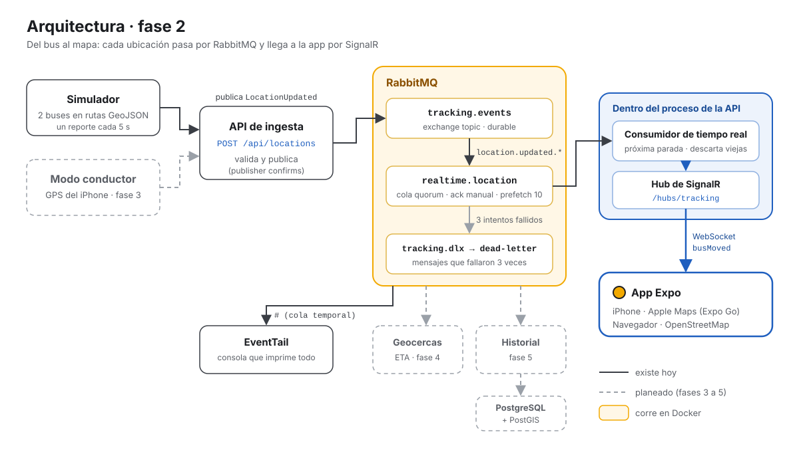
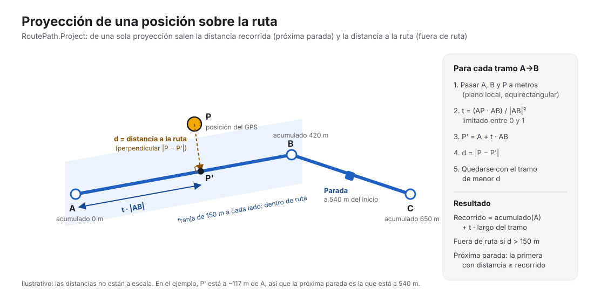

# Documento técnico · realtime-bus-tracking

Estado al cierre de la **fase 3 de 5** (noviembre de 2026). Describe qué se construyó, cómo funciona, qué decisiones se tomaron y por qué, y qué cambiaría en una implementación con GPS real. Para correr el proyecto, ver el [README](../README.md). Para el plan de cada fase, ver [`docs/handoffs/`](handoffs/).

## Índice

1. [Propósito y alcance](#1-propósito-y-alcance)
2. [Arquitectura](#2-arquitectura)
3. [El camino de una ubicación](#3-el-camino-de-una-ubicación)
4. [Contratos y API](#4-contratos-y-api)
5. [Mensajería con RabbitMQ](#5-mensajería-con-rabbitmq)
6. [Lógica geoespacial](#6-lógica-geoespacial)
7. [Reglas de negocio](#7-reglas-de-negocio)
8. [Tiempo real con SignalR](#8-tiempo-real-con-signalr)
9. [App móvil](#9-app-móvil)
10. [Calidad: pruebas, CI y convenciones](#10-calidad-pruebas-ci-y-convenciones)
11. [Decisiones y ajustes](#11-decisiones-y-ajustes)
12. [Limitaciones y camino a producción con GPS real](#12-limitaciones-y-camino-a-producción-con-gps-real)
13. [Métricas](#13-métricas)
14. [Historia por fase](#14-historia-por-fase)

---

## 1. Propósito y alcance

Es una prueba de concepto (POC), no un producto: buses escolares reportan su ubicación y los padres los ven moverse en un mapa en tiempo real. El objetivo técnico es demostrar tres cosas:
- un flujo de eventos **desacoplado** con RabbitMQ;
- la **entrega en tiempo real** con SignalR;
- una **app móvil** (React Native con Expo) que funciona en un iPhone real.

**Dentro del alcance (fases 1 a 3):**
- un simulador de buses;
- la API de ingesta;
- RabbitMQ con colas durables, *ack* manual, idempotencia y cola de fallidos;
- el consumidor de tiempo real y el hub de SignalR;
- la app con el mapa en vivo (modo padre) y el envío del GPS real (modo conductor).

**Fuera del alcance:**
- geocercas y ETA (fase 4);
- historial en PostgreSQL y CRUD de buses (fase 5);
- GPS en segundo plano y notificaciones push (fase 6, que necesita una cuenta de Apple Developer);
- autenticación, multiempresa y despliegue en la nube.

Todos los datos son **ficticios**: buses, rutas y paradas inventados.

## 2. Arquitectura



### Proyectos del backend (.NET 10, `backend/BusTracking.slnx`)

| Proyecto | Responsabilidad | Depende de |
| --- | --- | --- |
| `BusTracking.Contracts` | Eventos y DTO compartidos (`record`), nombres de la topología y del hub, opciones de JSON | — |
| `BusTracking.Core` | Lógica pura: geometría, validación, rutas, próxima parada, idempotencia, posiciones y flota. Sin infraestructura | Contracts |
| `BusTracking.Messaging` | Conexión con RabbitMQ, topología, publicador con confirmaciones y consumidor base | Contracts, Core |
| `BusTracking.Api` | Minimal API de ingesta, rutas y flota; hub de SignalR; consumidor de tiempo real | Contracts, Core, Messaging |
| `BusTracking.Simulator` | Consola que mueve buses sobre rutas GeoJSON y llama a la API | Contracts, Core |
| `BusTracking.EventTail` (tools) | Consola de depuración que imprime todos los eventos | Contracts, Messaging |

### Infraestructura

`infra/docker-compose.yml` levanta **RabbitMQ 4 con el panel de administración**. El código .NET y la app corren directamente en el PC, con `dotnet run` y `npx expo start`.

### App (`mobile/`)

- Expo **SDK 58**, React Native 0.88 y TypeScript estricto.
- Apple Maps en el iPhone (`react-native-maps`) y OpenStreetMap en el navegador (`react-leaflet`).
- `@microsoft/signalr` para el tiempo real y `expo-location` para el GPS.

## 3. El camino de una ubicación

```
Productor ─POST─▶ API ─publica (confirm)─▶ tracking.events ─location.updated.*─▶ realtime.location
                                                                                    │
                     App ◀─SignalR busMoved─ Hub (grupo route:{id}) ◀─ RealtimeLocationConsumer
```

1. **Productor.** El simulador o el iPhone en modo conductor envía un `LocationReport` a `POST /api/locations`.
2. **Validación.** `LocationReportValidator` revisa el reporte. Si no es válido, la API responde `400` con los errores en español.
3. **Publicación.** La API crea `LocationUpdated` con un `eventId` nuevo y lo publica en `tracking.events` con la clave `location.updated.{routeId}`. Espera la **confirmación del broker**:
   - si la recibe, responde `202 { eventId }`;
   - si no, responde `503`.
4. **Enrutamiento.** RabbitMQ copia el mensaje a cada cola enlazada. Hoy son dos: `realtime.location` y la cola temporal de EventTail, si está abierta.
5. **Consumo.** `RealtimeLocationConsumer`:
   - descarta el mensaje si su `eventId` ya se procesó;
   - calcula la próxima parada y la distancia a la ruta;
   - descarta la posición si es más vieja que la última del bus;
   - envía `busMoved` al grupo de la ruta;
   - confirma el mensaje con *ack*.
6. **App.** Aplica la posición si es más nueva que la que ya tiene y anima el marcador.

## 4. Contratos y API

### Eventos y DTO (`BusTracking.Contracts`)

| Tipo | Campos principales | Uso |
| --- | --- | --- |
| `LocationReport` | `busId`, `routeId`, `latitude`, `longitude`, `speedKmh`, `heading`, `recordedAt` | El cuerpo de `POST /api/locations` |
| `LocationUpdated` | `eventId` + los campos del reporte | El evento en RabbitMQ |
| `BusPosition` | `LocationUpdated` + `nextStopId`, `nextStopName`, `distanceFromRouteMeters` | El evento `busMoved` por SignalR |
| `RouteSummary` y `RouteDetails` | Id, nombre, recorrido y paradas | Para dibujar la ruta |
| `BusStatus` | `busId`, `inUse`, `routeId`, `lastSeenAt` | La flota |

JSON en camelCase (`TrackingJson`) y fechas en UTC con `DateTimeOffset` (ISO 8601).

### Endpoints

| Endpoint | Respuesta |
| --- | --- |
| `POST /api/locations` | `202 { eventId }`, `400` con `ValidationProblem` o `503` si RabbitMQ no está disponible |
| `GET /api/routes` | La lista de rutas |
| `GET /api/routes/{routeId}` | El recorrido y las paradas, o `404` en español |
| `GET /api/buses` | La flota (`Fleet:BusIds`) y si cada bus está en uso |
| `GET /health` | `200` mientras la conexión con RabbitMQ esté abierta |
| SignalR `/hubs/tracking` | `JoinRoute(routeId)` devuelve las posiciones actuales y une al grupo; `LeaveRoute`; evento `busMoved` |

## 5. Mensajería con RabbitMQ

### Topología

| Elemento | Tipo | Propiedades |
| --- | --- | --- |
| `tracking.events` | Exchange `topic` | Durable |
| `realtime.location` | Cola **quorum** | Durable, `x-dead-letter-exchange: tracking.dlx`, `x-delivery-limit: 2` (3 entregas en total); enlazada con `location.updated.*` |
| `tracking.dlx` | Exchange `fanout` | Durable |
| `tracking.dead-letter` | Cola quorum | Recibe los mensajes fallidos para revisarlos |
| Cola de EventTail | Exclusiva y temporal | *Auto-ack*, solo para depurar |

Cada servicio declara la topología al abrir su canal (`TopologyInitializer`). Declarar es **idempotente**, así que no importa el orden en que arranquen los servicios.

### Garantías y cómo se logran

| Garantía | Mecanismo |
| --- | --- |
| No perder mensajes aceptados | Exchange y colas durables, mensajes persistentes y **publisher confirms**. La API solo responde `202` después de la confirmación |
| No perder mensajes en el consumidor | **Ack manual** después de procesar. Si el proceso se cae, RabbitMQ vuelve a entregar el mensaje |
| No saturar al consumidor | `prefetch = 10` |
| No procesar dos veces | Idempotencia por `eventId` (`RecentEventIds`). La entrega es "al menos una vez" (*at-least-once*) |
| No bloquear la cola con un mensaje que siempre falla | `basic.reject` con *requeue*. La cola quorum cuenta las entregas y, después de 3, lo pasa a `tracking.dead-letter`. Un mensaje ilegible va directo ahí |
| Aislamiento entre consumidores | Una cola por consumidor. Si un consumidor se cae, sus mensajes esperan en su cola y los demás siguen |
| Recuperación ante caídas de red | `AutomaticRecoveryEnabled` en la conexión. El consumidor reintenta cada 5 s si RabbitMQ no está listo al arrancar |

### El consumidor base: `RabbitMqConsumer<T>`

Es un `BackgroundService` que aplica el patrón **template method**: la base maneja el transporte y cada consumidor concreto solo implementa `HandleAsync(T)`. Así decide qué hacer con cada mensaje:

| Caso | Acción |
| --- | --- |
| Sin `MessageId` o JSON inválido | `reject(requeue: false)` → cola de fallidos |
| `eventId` ya procesado | `ack`, sin procesarlo otra vez |
| `HandleAsync` lanza una excepción | `reject(requeue: true)` → se reintenta hasta el límite |
| Procesado bien | Registrar el `eventId` y hacer `ack` |

El `eventId` se registra **después** de procesar bien. Si se registrara antes, un intento fallido se tomaría como duplicado en el reintento y el mensaje se perdería.

> **RabbitMQ 4.3+:** `basic.nack` ya no cuenta para `x-delivery-limit`; solo `basic.reject` cuenta. Con `nack`, un mensaje que siempre fallaba se reintentó 3767 veces en 15 s, en una prueba de integración. Por eso el consumidor usa `reject`.

## 6. Lógica geoespacial

Toda la lógica está en `BusTracking.Core`. Es pura: no usa librerías geoespaciales ni toca infraestructura.

| Algoritmo | Clase | Detalle |
| --- | --- | --- |
| **Haversine** | `GeoMath.DistanceMeters` | Distancia sobre la esfera, con radio de 6 371 000 m |
| **Rumbo inicial** | `GeoMath.BearingDegrees` | De 0° a 360°, donde 0° es el norte |
| **Distancias acumuladas** | `RoutePath` (constructor) | Se precalcula la distancia desde el inicio hasta cada vértice |
| **Posición a una distancia** | `RoutePath.PositionAt` | Búsqueda binaria del tramo en O(log n) e interpolación lineal. La usa el simulador |
| **Proyección sobre un segmento** | `RoutePath.Project` | Ver el diagrama |
| **Próxima parada** | `RouteDefinition.NextStop` | La primera parada (por `order`) a la misma distancia del inicio que el bus o más adelante; al final vuelve a la primera; `null` fuera de ruta |



Cada tramo se proyecta sobre un **plano local** (equirectangular: `x = Δlon · cos(lat) · k` e `y = Δlat · k`), porque el error es mínimo en tramos de cientos de metros. Una sola proyección da dos resultados:
- la **distancia recorrida**, que alimenta la próxima parada;
- la **distancia a la línea**, que decide si el bus está fuera de ruta.

**Límite conocido:** una ruta que pasa dos veces por la misma calle puede proyectarse al tramo equivocado. Está comentado en el código.

## 7. Reglas de negocio

| Regla | Valor | Motivo | Dónde |
| --- | --- | --- | --- |
| Rango de latitud y longitud | ±90 y ±180 | Rechazar coordenadas imposibles | `LocationReportValidator` |
| Velocidad | 0 a 150 km/h | Límite físico razonable para un bus | Validador y `report.ts` |
| Rumbo | 0 a 360 | Grados desde el norte | Validador |
| `recordedAt` | Entre −1 h y +1 min | Tolerar pequeñas diferencias de reloj y descartar datos muy viejos | Validador |
| Frecuencia de reporte | 1 cada 5 s | Fluidez en el mapa frente a batería y volumen | Simulador y `SEND_INTERVAL_MS` |
| Precisión mínima del GPS | ≤ 30 m | Una lectura imprecisa hace saltar el bus | `MAX_ACCURACY_METERS` |
| Fuera de ruta | > 150 m de la línea | El error del GPS en ciudad es de 10 a 50 m | `OffRouteThresholdMeters` |
| Posición vieja | `recordedAt` ≤ la última del bus → se descarta | El bus nunca retrocede en el mapa | `BusPositionTracker` y `busStore.ts` |
| Bus en uso | Reportó en los últimos 60 s | Evitar dos conductores en el mismo bus | `FleetStatus.InUseWindow` |
| Conductor quieto | Reenvía la última lectura con la hora actual si tiene ≤ 30 s | iOS deja de dar lecturas si el teléfono no se mueve | `planSend` |
| Velocidad o rumbo desconocidos | Velocidad 0 y el último rumbo conocido | El GPS envía `-1` o `null` | `toKmh` y `toHeading` |
| Idempotencia | Los últimos 10 000 `eventId` | Memoria acotada | `RecentEventIds` |

## 8. Tiempo real con SignalR

- **Grupos por ruta (`route:{routeId}`).** Cada cliente recibe solo los buses de su ruta.
- **Foto inicial.** `JoinRoute` devuelve las posiciones actuales (`BusPositionTracker.GetByRoute`), así que el mapa se llena enseguida.
- **Reconexión.** El cliente usa una política propia: reintenta a los 0, 2 y 5 s, y después cada 10 s, sin rendirse. Al reconectar **vuelve a llamar a `JoinRoute`**, porque los grupos no sobreviven a una reconexión. Si la primera conexión falla, reintenta cada 5 s.
- **Doble filtro de posiciones viejas.** El servidor y el cliente aplican la misma regla, porque los mensajes pueden llegar fuera de orden.
- **CORS:** `Cors:AllowedOrigins` permite la versión web de Expo (`localhost:8081`) solo en Development.

## 9. App móvil

### Estructura (`mobile/src/`)

| Archivo | Rol |
| --- | --- |
| `api.ts`, `tracking.ts` | Cliente HTTP y conexión de SignalR |
| `busStore.ts` | Lógica pura: la última posición de cada bus, sin retroceder |
| `useLiveRoute.ts` | Hook: carga la ruta, sigue los buses y mide la latencia en desarrollo |
| `components/LiveMap.tsx` y `LiveMap.web.tsx` | Mapa nativo (Apple Maps) y web (Leaflet + OpenStreetMap), con las mismas props |
| `components/useSmoothCoordinate.ts` | Animación de unos 1,2 s entre posiciones, para que el bus no salte |
| `screens/ParentScreen.tsx` | Modo padre: mapa, lista y detalle del bus |
| `screens/DriverScreen.tsx` y `driver/*` | Modo conductor: flota, GPS, envío y pantallas del mock-up |
| `driver/report.ts` | Lógica pura del GPS: filtro de precisión, conversiones y `planSend` |

### El GPS en el modo conductor

```
watchPositionAsync (1 s) ─▶ última lectura ─(cada 5 s)─▶ planSend ─▶ toLocationReport ─▶ POST /api/locations
                                                          │                │
                                            "waiting" si no hay o es vieja   "inaccurate" si > 30 m
```

La posición del propio bus que se ve en el mapa del conductor es la que **devuelve el servidor por SignalR**. Eso demuestra que la posición recorrió todo el camino.

## 10. Calidad: pruebas, CI y convenciones

| Suite | Pruebas | Qué cubre |
| --- | --- | --- |
| `BusTracking.Core.Tests` | 64 | Geometría, proyección, próxima parada, fuera de ruta, validador, `RouteLoader`, idempotencia, tracker y flota |
| `BusTracking.Simulator.Tests` | 5 | Movimiento y variación de velocidad del simulador |
| `BusTracking.Api.IntegrationTests` | 17 | Con **Testcontainers** (un RabbitMQ real) y `WebApplicationFactory`: ingesta, rutas, flota, reintentos, cola de fallidos, idempotencia y el camino completo hasta un **cliente SignalR real** |
| App (jest, preset `jest-expo/node`) | 48 | `busStore`, formatos, latencia y la conversión del GPS (`planSend`) |

- **CI (GitHub Actions)**, en cada PR y en cada push a `main`:
  - job `backend`: restore, build, `dotnet format --verify-no-changes` y test;
  - job `mobile`: `npm ci`, typecheck, `expo lint` y jest.
- **Prácticas en .NET 10:**
  - `record` para contratos y Nullable habilitado;
  - el tipo `System.Threading.Lock`, *collection expressions* y *raw strings*;
  - async de punta a punta con `CancellationToken`;
  - `TimeProvider` para poder controlar el tiempo en las pruebas;
  - `IOptions` y *User Secrets* para la clave de RabbitMQ;
  - logs estructurados con plantillas;
  - Minimal APIs con `ProblemDetails`;
  - gestión central de paquetes (`Directory.Packages.props`).
- **Convenciones (`CLAUDE.md`):**
  - todo lo técnico en inglés y los textos para el usuario en español;
  - PascalCase en tipos y `_camelCase` en campos;
  - JSON en camelCase;
  - Conventional Commits;
  - nada de abstracciones sin uso: la única es `RabbitMqConsumer<T>`, que reutilizarán las fases 4 y 5.

## 11. Decisiones y ajustes

| Decisión | Contexto | Resultado |
| --- | --- | --- |
| `RabbitMQ.Client` oficial, sin MassTransit | Entender los fundamentos; MassTransit cambió su modelo de licencia | Conexión, topología, publicador y consumidor escritos a mano |
| Colas **quorum** | Cuentan las entregas y permiten un límite de reintentos sin código propio | Cola de fallidos después de 3 intentos |
| `basic.reject` en vez de `basic.nack` | En RabbitMQ 4.3+ `nack` no cuenta para `x-delivery-limit` | Se evita el bucle infinito de reintentos |
| Próxima parada calculada en el servidor | La app no repite lógica geográfica, y la fase 4 reutiliza el avance sobre la ruta | `BusPosition` la incluye |
| Expo **SDK 58** (no 54) | El Expo Go del App Store solo abre el SDK más reciente | Necesita iOS 16.4 o superior y una cuenta de Expo |
| Apple Maps en iOS y OpenStreetMap en web | `react-native-maps` no funciona en web | Un componente por plataforma, con las mismas props |
| Reenviar con el conductor quieto | La prueba en el iPhone mostró "Enviando" pero con el último envío "hace 12 s" | `planSend` reenvía la última lectura fresca |
| Perfil `lan`, Firewall y red privada | El iPhone no llega a `localhost` | La API escucha en `0.0.0.0:5080`, con los puertos 5080 y 8081 abiertos |
| Paquetes de prueba más nuevos | Vulnerabilidades conocidas en dependencias (SSH.NET, SignalR.Common) | Testcontainers 4.17 y SignalR.Client 10.0.15 |
| Preset `jest-expo/node` | El preset por defecto falla en el SDK 58 | Las pruebas de lógica pura corren en Node |
| Sin GIF del modo conductor | El video mostraba la ubicación real de quien probaba | Solo se publicó el GIF del modo padre, con datos simulados |

## 12. Limitaciones y camino a producción con GPS real

**Lo que ya aplica con GPS real:** el filtro de precisión, descartar las posiciones viejas, el umbral de fuera de ruta, el reenvío con el conductor quieto, la cola durable con reintentos y la idempotencia.

**Lo que habría que cambiar:**

| Tema | Hoy | En producción |
| --- | --- | --- |
| `eventId` | Lo genera la API | Lo debe generar el **dispositivo**. Si un `POST` se reintenta porque se perdió el `202`, hoy se crea otro `eventId` y la idempotencia no lo detecta |
| Sin conexión | La posición se descarta | Guardar las posiciones en el dispositivo y enviarlas en orden al volver la red; la regla de posiciones viejas protege el mapa |
| Reloj | `recordedAt` del dispositivo | Guardar también la hora de llegada al servidor y detectar relojes desfasados |
| Segundo plano | Solo con la app abierta (Expo Go) | *Development build* o app publicada con permiso "Siempre" (fase 6) |
| Calidad del recorrido | Filtro por precisión | Suavizado (Kalman), ajuste a las calles (*map matching*) y rumbo calculado con el movimiento |
| Estado | Idempotencia y última posición en memoria | Persistirlas en PostgreSQL (fase 5) |
| Seguridad | `POST /api/locations` abierto en la red local | Autenticar a dispositivos y conductores; TLS |
| Escala | Un solo proceso | *Backplane* de SignalR (Redis), clúster de RabbitMQ y varios consumidores por cola |
| Rendimiento | La proyección se calcula 3 veces por mensaje y la distancia de las paradas en cada mensaje | Precalcular la distancia de las paradas al cargar la ruta y proyectar una sola vez |
| Privacidad | Datos ficticios | Definir quién ve las ubicaciones, cuánto tiempo se guardan y su anonimización |

## 13. Métricas

| Camino | p50 | p95 | Fuente |
| --- | --- | --- | --- |
| Simulador → RabbitMQ → EventTail | 4 ms | 16 ms | Fase 1, 26 mensajes en un PC local |
| Hasta la app (`ahora - recordedAt`) | Pendiente | Pendiente | La app lo escribe cada minuto en la terminal de Expo |

Precisión del GPS observada en un iPhone: **±12 a 14 m** (fase 3).

## 14. Historia por fase

| Fase | PR | Resultado |
| --- | --- | --- |
| 1 · Ingesta, RabbitMQ y simulador | [#1](https://github.com/juancitowillyr46/realtime-bus-tracking/pull/1) | El simulador publica `LocationUpdated` y EventTail lo imprime |
| 2 · Tiempo real en el mapa | [#2](https://github.com/juancitowillyr46/realtime-bus-tracking/pull/2) | Cola durable con DLX, hub de SignalR y app con el mapa en el iPhone y en el navegador |
| 3 · Modo conductor | [#3](https://github.com/juancitowillyr46/realtime-bus-tracking/pull/3) | El iPhone envía su GPS real; flota; fuera de ruta |
| 4 · Geocercas y alertas | — | Siguiente |
| 5 · Historial y administración | — | Planeada |
